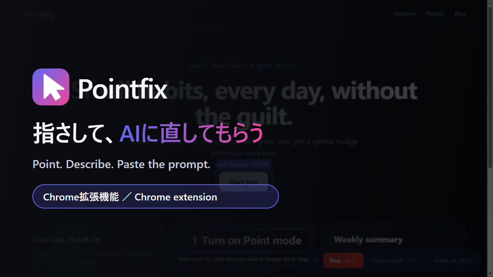

# Pointfix

**日本語** | [English](README.md)



サイトの一部を指さして、AIエージェントにそのまま渡せるプロンプトをコピーする Chrome 拡張機能です（Manifest V3）。

AIにサイトを作ってもらったあと、修正を言葉で説明するのが一番大変でした。

> 「あの、上のほうの、青いボタンみたいなやつを、もうちょっと大きく…」

Pointfix なら、直したいところを**クリックして、やってほしいことを書くだけ**。URL・場所・CSSセレクタ入りの指示文ができあがるので、Claude / ChatGPT / Cursor などのAIに貼るだけです。

## 使い方（3ステップ）

1. **指さしモードを始める** — `Alt+S` を押すか、画面右下のバーの **Start** を押します。
2. **直したいところをクリック** — やってほしいことを書いて **Add point**（または `Ctrl+Enter`）を押します。番号付きの点線の枠がページに残ります。あとから番号をクリックすると、その点を編集・削除できます。
3. **プロンプトをコピー** — `Alt+C`（またはバーの **Copy prompt**）を押して、AIエージェントに貼ります。

`Alt+S` か `Esc` で指さしモードを止めます。同じサイトの別ページで付けた点も残るので、1つのプロンプトで複数のページをまとめて指示できます。

## 生成されるプロンプトの例

```markdown
Please update the web pages below as described. Change only the annotated elements.
After the changes, briefly tell me what you changed.

# Annotations

## Annotation 1
**URL**: https://example.com/
**Target**: `button#cta`
**Source**: `src/components/Hero.tsx:24:9` (Hero)
**TagName**: BUTTON
**Inner Content**: Sign up
**Current**: 120×40px; font 15px / 700; color #ffffff; background #1d9bf0; padding 10px 18px; radius 999px
**Instruction**: make it bigger and blue

## Annotation 2
**URL**: https://example.com/pricing
**Target**: `#plan-pro`
**TagName**: DIV
**Inner Content**: Pro plan
**Instruction**: move this above the free plan
```

## ショートカット

| 操作 | キー |
| --- | --- |
| 指さしモードの開始／停止 | `Alt+S` |
| 親要素を選ぶ／子要素に戻る | `↑` / `↓`（指さし中） |
| プロンプトをコピー | `Alt+C` |
| このサイトの点をすべて削除 | `Alt+X` |
| 指さしモードを止める | `Esc` |

- 画面右下のバーに、同じ操作がボタンで並んでいます。バーの左側の点の並び（つかみどころ）をドラッグすると、好きな位置に動かせます。位置は覚えられます。つかみどころをダブルクリックすると、右下に戻ります。
- ツールバーの **Pointfix アイコン**を押すと、すべてのページでバーの表示・非表示を切り替えられます。バーを隠しているときは、ショートカットを使ってください。
- ショートカットは `chrome://extensions/shortcuts` で変えられます。

## 主な機能

- 👆 **ホバーで枠、クリックで指定** — 指している要素の説明が、短いラベルで出ます。
- 🏷 **点線の枠と番号** — 点は付けたページに残り、番号はプロンプトの番号と一致します。
- 🔗 **複数ページをまとめて指示** — 1ページ内だけでなく、単一ページのサイトにも対応しています。それぞれの指示に URL が入ります。
- 🗂 **点はサイトごと** — 点の数、Copy prompt、Delete all は、開いているサイトの点だけを使います。別のプロジェクトの点がプロンプトに混ざることはありません。
- ✏️ **1つずつ編集・削除** — 番号をクリックします。
- ↕️ **親要素・子要素への切り替え** — 指さし中に `↑` を押すと、枠の付いた要素の親（例：1行ではなくカード全体）に切り替わります。`↓` で戻ります。マウスを動かすと、カーソルの下の要素からやり直します。
- 📍 **ソースの場所** — 開発サーバーで動かしているときは、要素がどのファイルの何行目から来ているか（例：`src/App.jsx:24:9 (App)`）をプロンプトに入れます。AI がすぐにコードを見つけられます。React 18/19 と Vue に対応し、Svelte、Angular（コンポーネント名のみ）、react-dev-inspector の情報も読みます。本番用のビルドにはこの情報がないため、そのときは入りません。
- 🎨 **今の値** — 要素の今の大きさ、文字、色、余白、枠線、角の丸みを入れます。「大きく」「もっと丸く」と書いたときに、AI が今の値から考えられます。
- 📋 **短いプロンプト** — URL、CSSセレクタ、ソースの場所、タグ名、文字、今の値、指示だけを入れます。
- 🔒 **完全ローカル動作** — データを外部サーバーに送りません。

### 動き

動きは CSS の `transform` と `opacity` だけで作っています。アニメーションのライブラリは使わず、ページを重くしないようにしています。

- 指さしモード中は、マウスより少し遅れて矢印がついてきます。
- ホバーの枠は、指している要素へなめらかに移動し、大きさも合わせます。
- クリックした場所から、リングが広がります。
- 新しい点は、少し弾んで現れます。編集画面とメッセージは、ふわっと表示されます。

OS の「視差効果を減らす」がオンのときは、これらの動きをすべて止めます。

## インストール（Chrome）

Chrome ウェブストアには公開しません。フォルダを読み込んで使います。1分ほどで終わります。

### 1. ファイルを取得する

**ZIP でダウンロード（Git 不要・おすすめ）**

1. **[ZIP をダウンロードする](https://github.com/nolozy/pointfix/archive/refs/heads/main.zip)**
2. `pointfix-main.zip` を展開します。
3. フォルダを消えない場所に置きます（例: `ドキュメント`）。
   - **注意:** 読み込んだあとにフォルダを移動・削除すると、拡張機能は動かなくなります。

**Git を使う場合**

```bash
git clone https://github.com/nolozy/pointfix.git
```

### 2. Chrome で読み込む

1. アドレスバーに `chrome://extensions` と入力して開きます。
2. 右上の「デベロッパー モード」をオンにします。
3. 左上の「パッケージ化されていない拡張機能を読み込む」を押します。
4. **`manifest.json` が直接入っているフォルダ**を選びます。ZIP を展開すると `pointfix-main/pointfix-main` のように二重になることがあるので、中のフォルダを選んでください。
5. 一覧に **Pointfix** が出れば完成です。

### 3. ピン留め（任意）

Chrome のツールバーのパズルアイコン 🧩 を押し、**Pointfix** をピン留めすると、アイコンが常に見えます。

> デベロッパー モードをオンにしたままだと、起動時に「デベロッパー モードの拡張機能を無効にしますか？」と聞かれることがあります。「キャンセル」を選べば、拡張機能はそのまま使えます。

## 制限

- **Chrome が保護しているページ:** `chrome://` のページ、Chrome ウェブストア、Chrome の PDF ビューアーでは使えません。
- **ローカルファイル（`file://`）:** 拡張機能の詳細で「ファイルの URL へのアクセスを許可」をオンにすると使えます。
- **1ページ内のサイト:** 点は残りますが、点の枠が描かれるのは、その要素が今のページにあるときだけです。

## プライバシー

Pointfix は、すべての処理をあなたのブラウザの中で行います。ページの内容や指示を外部に送ることはありません。点はブラウザのローカルストレージだけに保存されます。

## 開発について

UISelector2AI の「要素を選んでAI用プロンプトにする」というアイデアに影響を受けています。Pointfix はそれを参考に、コードをゼロから独自に実装しました。

## ファイル構成

```
pointfix/
├── manifest.json     Manifest V3
├── background.js     サービスワーカー: ツールバーのアイコン、ショートカット、バーの表示切り替え
├── content.js        指さしモード、バー、枠、プロンプト
├── page-probe.js     ページ側で動き、コンポーネント名とソースの場所を読む
├── content.css       ページ内の UI のスタイル
├── icons/            拡張機能のアイコン（Chrome 用の PNG と、元になる SVG）
├── docs/             この README で使う画像
├── README.md         English
└── README.ja.md      日本語
```

## ライセンス

MIT License
