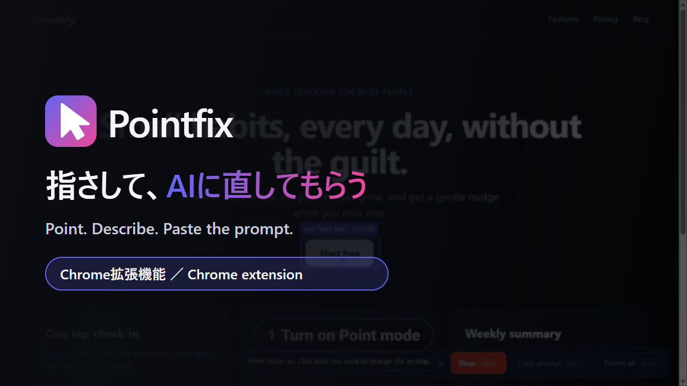

# Pointfix

[日本語](README.ja.md) | **English**



Point at any part of a web page, describe the change, and copy a short prompt for your AI agent. A Chrome extension (Manifest V3).

Describing a small UI change in words is hard: "the blue button at the top, make it a bit bigger…". With Pointfix you click the exact part, type what should change, and paste the prompt into Claude, ChatGPT, Cursor, or any AI agent.

## How to use

1. **Start Point mode** — press `Alt+S`, or click **Start** on the bar at the bottom right.
2. **Click the part you want to change** — type what should change and press **Add point** (or `Ctrl+Enter`). A dashed box with a number stays on the page. Click the number later to edit or delete that point.
3. **Copy the prompt** — press `Alt+C` (or **Copy prompt**), then paste it into your AI agent.

Press `Alt+S` or `Esc` to stop Point mode. Points on other pages of the same site are kept too, so one prompt can cover several pages.

## Example prompt

```markdown
Please update the web pages below as described. Change only the annotated elements.
After the changes, briefly tell me what you changed.

# Annotations

## Annotation 1
**URL**: https://example.com/
**Target**: `button#cta`
**Source**: `src/components/Hero.tsx:24:9` (Hero)
**TagName**: BUTTON
**Inner Content**: Sign up
**Instruction**: make it bigger and blue

## Annotation 2
**URL**: https://example.com/pricing
**Target**: `#plan-pro`
**TagName**: DIV
**Inner Content**: Pro plan
**Instruction**: move this above the free plan
```

## Controls

| Action | Key |
| --- | --- |
| Start / stop Point mode | `Alt+S` |
| Copy the prompt | `Alt+C` |
| Delete all points on this site | `Alt+X` |
| Stop Point mode | `Esc` |

- The bar at the bottom right has the same actions as buttons. Drag its grip (the dots on the left) to move it anywhere; the place is remembered. Double-click the grip to put it back in the bottom-right corner.
- Click the **Pointfix icon** in the toolbar to show or hide the bar on every page. When the bar is hidden, use the shortcuts.
- You can change the shortcuts at `chrome://extensions/shortcuts`.

## Features

- **Hover to highlight, click to point** — a short label shows what you are pointing at.
- **Dashed boxes with numbers** — points stay visible on the page where they were made, and the numbers match the prompt.
- **Several pages in one prompt** — works on single-page sites too. Each annotation carries its own URL.
- **Points stay with their site** — the count, Copy prompt and Delete all only use the points of the site you have open, so points from another project never end up in the prompt.
- **Edit or delete one point** — click its number.
- **Source location** — on a dev server, the prompt says which file and line the element comes from (for example `src/App.jsx:24:9 (App)`), so the agent goes straight to the code. Works with React 18/19 and Vue; Svelte, Angular (component name only) and react-dev-inspector are read too. Production builds have no source data, so the line is left out there.
- **Short prompt** — the URL, a CSS selector, the source, the tag name, the text, and your instruction. Nothing else.
- **Runs locally** — nothing is sent to any server.

### Motion

The motion uses only CSS `transform` and `opacity`, with no animation library, to keep pages light.

- An arrow cursor follows the mouse with a slight delay while Point mode is on.
- The hover frame slides and resizes to the element you point at.
- A ring expands from each click.
- New boxes pop in, and the editor and messages fade in.

When the OS setting "Reduce motion" is on, all of these are turned off.

## Install (Chrome)

Pointfix is not on the Chrome Web Store, so you load the folder directly. It takes about a minute.

### 1. Get the files

**Download as ZIP (no Git needed, recommended)**

1. **[Click here to download the ZIP](https://github.com/nolozy/pointfix/archive/refs/heads/main.zip)**.
2. Unzip `pointfix-main.zip`.
3. Put the folder somewhere permanent (for example in `Documents`).
   - **Note:** if you move or delete the folder after loading it, the extension stops working.

**Or with Git**

```bash
git clone https://github.com/nolozy/pointfix.git
```

### 2. Load it in Chrome

1. Open `chrome://extensions` in the address bar.
2. Turn on **Developer mode** (top right).
3. Click **Load unpacked** (top left).
4. Select the folder that **directly contains `manifest.json`**. After unzipping there may be a folder inside a folder (`pointfix-main/pointfix-main`), so pick the inner one if needed.
5. **Pointfix** should appear in the list.

### 3. Pin it (optional)

Click the puzzle-piece icon 🧩 in Chrome's toolbar and pin **Pointfix** so the icon is always visible.

> While Developer mode is on, Chrome may ask on startup whether to disable extensions running in developer mode. Choose "Cancel" and the extension keeps working.

## Limitations

- **Pages Chrome protects:** `chrome://` pages, the Chrome Web Store and Chrome's PDF viewer cannot be used.
- **Local files** (`file://`) need "Allow access to file URLs" turned on in the extension's details.
- **Single-page sites** keep the same points, but a point is drawn only when its element is on the current page.

## Privacy

Pointfix runs entirely in your browser. It does not send page content or your instructions anywhere. Points are stored in the browser's local storage only.

## Background

The idea was inspired by UISelector2AI, which turns a selected element into a prompt for AI. Pointfix is a separate implementation written from scratch.

## Files

```
pointfix/
├── manifest.json     Manifest V3
├── background.js     Service worker: toolbar icon, shortcuts, bar visibility
├── content.js        Point mode, the bar, the boxes and the prompt
├── page-probe.js     Runs in the page to read the component and source location
├── content.css       Styles of the in-page UI
├── icons/            Extension icons (PNG for Chrome, SVG source)
├── docs/             Images used in this README
├── README.md         English
└── README.ja.md      Japanese
```

## License

MIT License
